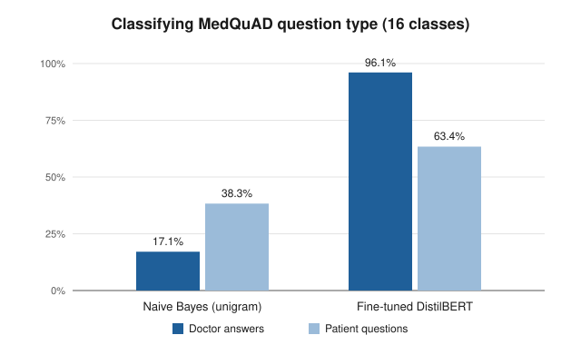

# Patient vs. Doctor Language in Medical NLP

**A fine-tuned DistilBERT model classifies medical text into 16 question types with 96.07% accuracy, but drops to 63.4% on the casual language patients actually use.**

This project compares three NLP approaches (named entity recognition, text classification and extractive question answering) on the MedQuAD dataset. It asks one question: *do models built on clinical text still work when patients write in their own words?*

Course project · BINF 5312 Natural Language Processing · Rutgers School of Health Professions · April 2026

---

## Why it matters
Doctors write in precise clinical terms, while patients ask short, informal questions. Any patient-facing tool, such as a symptom checker, a portal chatbot or message triage, has to handle both. A model that only looks accurate on clinical text can quietly fail the people it is meant to serve.

## Data
- **MedQuAD**, via Kaggle: [Comprehensive Medical Q&A Dataset](https://www.kaggle.com/datasets/thedevastator/comprehensive-medical-q-a-dataset) (The Devastator, 2023)
- 16,407 question–answer pairs used, each labeled with one of **16 question types** (symptoms, treatment, causes, inheritance, etc.)
- `Question` = patient-style wording · `Answer` = healthcare-professional wording
- 80/20 train/test split (13,125 / 3,282)

The dataset is not included in this repository. Download `train.csv.zip` from Kaggle and place it next to the notebooks.

## Methods and notebooks
| # | Notebook | Method |
|---|---|---|
| 01 | `01_named_entity_recognition.ipynb` | Biomedical NER with scispaCy `en_ner_bc5cdr_md` (diseases and chemicals) |
| 02 | `02_naive_bayes_ngrams_questions.ipynb` | Naive Bayes with unigram, bigram and trigram features on patient questions |
| 03 | `03_naive_bayes_ngrams_answers.ipynb` | The same baseline on doctor answers |
| 04 | `04_distilbert_text_classification.ipynb` | Fine-tuned DistilBERT (8 epochs) trained on doctor answers, then tested on both answers and patient questions |
| 05 | `05_extractive_qa_bert_large.ipynb` | Extractive QA with pre-trained BERT-Large (SQuAD) |
| 06 | `06_distilbert_finetuned_qa.ipynb` | DistilBERT fine-tuned on SQuAD for QA (1 epoch), for comparison |

## Results



**Text classification (16 classes)**

| Model | Doctor answers | Patient questions |
|---|---|---|
| Naive Bayes, unigram | 17.1% | 38.3% |
| Naive Bayes, bigram | 11.6% | 19.3% |
| Naive Bayes, trigram | *re-run pending (see note)* | 20.3% |
| **Fine-tuned DistilBERT** (trained on answers) | **96.07%** | **63.4%** |

- On a single example, DistilBERT's confidence was **99.9%** on a doctor answer but **46%** on a patient question.
- **NER:** the model found diseases and chemicals in doctor answers, such as *leukopenia*, *thrombocytopenia* and *glucose*. In the 10 patient questions tested, it found **no entities at all**.
- **Question answering** ("What are the symptoms of LCM?"): pre-trained BERT-Large returned the complete, correct first-phase symptom list (*fever, malaise, lack of appetite, muscle aches, headache, nausea, vomiting*). The SQuAD-tuned DistilBERT returned rarer late-stage symptoms with 0.73 confidence.

## Key insight
**All three methods performed worse on patient language than on clinical language.** DistilBERT lost about 33 points of accuracy when moving from doctor answers to patient questions, and NER found nothing in lay wording. For patient-facing clinical AI, this means models need training or evaluation on real patient language before they are trusted with patients.

## How to run
Google Colab with a GPU is recommended for notebooks 04–06.
```bash
pip install -r requirements.txt
```
Then open the notebooks in order. Notebook 01 pins `numpy==1.26.4` for scispaCy compatibility.

## Notes and limitations
- **Code fix (Oct 2026):** in notebook 03, the trigram classifier was originally trained on unigram features. That is now fixed, and the trigram/answer result needs to be re-run, so its outputs were cleared.
- In notebook 04, the best checkpoint was selected using the same split that was later used for testing, so the 96.07% figure may be slightly optimistic. A separate validation split would fix this.
- The DistilBERT model was never trained on patient questions. The 63.4% result shows how well it transfers across language styles, not how well it could do if trained on them.

## Tools
Python · pandas · NLTK · scikit-learn · Hugging Face Transformers & Datasets · PyTorch · spaCy / scispaCy

---
**Reeya Dave** · M.S. Health Informatics (AI in Healthcare), Rutgers · [LinkedIn](https://www.linkedin.com/in/reeyamdave)
